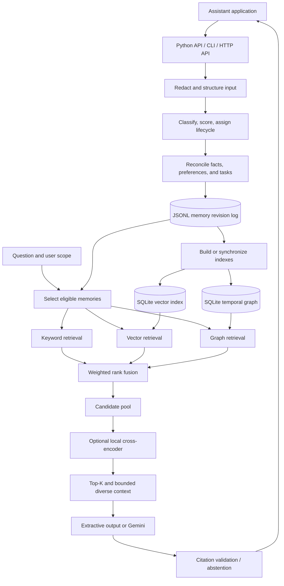

# CogniMem: what we are building and why

> **Project objective:** Build a persistent, inspectable memory backend that lets an AI assistant remember useful information across conversations, track how that information changes, and retrieve the right evidence for a personalized, cited answer.

This document explains the intended product and connects it to the current source code. It separates implemented mechanisms from outcomes that still require evaluation. It is a project definition, not a claim that every conversational problem is solved.

## 1. The problem we are trying to solve

A useful assistant needs continuity. A user should not have to repeat their preferences, project context, location, or outstanding tasks in every session. However, storing a transcript and searching similar sentences does not provide reliable memory by itself.

Consider these statements received on different days:

- “I live in Chennai.”
- “I work at Acme.”
- “Acme is based in Bengaluru.”
- “I moved to Bengaluru.”
- “I prefer short technical explanations.”

The assistant needs different evidence for “Where do I live now?”, “Where did I live before?”, and “Where is my employer based?” It should also use the communication preference when answering. Retrieving an old location because it has similar wording would produce a plausible but outdated answer.

The problems are therefore connected:

| Problem | What the memory system must do |
| --- | --- |
| Useful information is buried in conversation | Identify and retain useful statements with their source. |
| Not everything deserves permanent retention | Distinguish temporary conversation, durable knowledge, events, and tasks. |
| Facts and preferences change | Represent current state while preserving relevant history. |
| Repetition fills storage and context | Consolidate supported equivalent observations without losing evidence. |
| Answers require relationships or time | Retrieve temporal assertions and supported relationship paths. |
| Similar text may not answer a question | Rank evidence carefully and evaluate answerability separately. |
| Generated answers can invent details | Require evidence, citations, and appropriate abstention. |
| Memories contain personal information | Enforce ownership, redact supported sensitive patterns, and support deletion. |

## 2. The product we want to deliver

CogniMem is a reusable component behind an assistant. The surrounding application provides the chat interface and decides when to save information or request context. CogniMem supplies memory processing, storage, updates, retrieval, and an optional answer-generation path.

The intended user experience is:

1. Tell the assistant something useful once.
2. Return in another session without repeating all the background.
3. Correct outdated information through a new statement or an explicit operation.
4. Ask questions about current facts, previous facts, preferences, tasks, and relationships.
5. Receive an answer supported by identifiable memories—or an honest refusal when evidence is insufficient.
6. Inspect, export, or delete stored information.

The application still owns consent, conversation UX, external integrations, and actions such as sending a reminder. Saving a task in CogniMem does not itself create a calendar event or send a notification.

### Practical day-to-day applications

| Application | Information to retain | Example value | Integration still needed |
| --- | --- | --- | --- |
| Personal assistant | Preferences, plans, relevant personal facts | Answer with the user's preferred level of detail and current circumstances. | Chat interface and consent controls. |
| Project assistant | Decisions, dependencies, people, changing project facts | Recover an earlier decision and identify its supporting conversation. | Project-tool ingestion and permission mapping. |
| Study assistant | Learning preferences, goals, reusable procedures | Carry study context across sessions. | Learning application and progress tracking. |
| Task assistant | Deadlines, recurring schedules, completion state | Retrieve outstanding work and track rescheduling. | Calendar connectors and reminder delivery. |

These are intended uses of the backend, not claims that all integrations already exist.

## 3. Two objectives: a useful backend and a defensible research experiment

The engineering objective is reliable conversational memory across its full lifecycle: save, revise, retrieve, explain, and eventually archive or delete.

The main research question is:

> **How much does adding temporal and relational graph retrieval improve vector-based conversational memory retrieval and RAG performance?**

The controlled experiment has four systems:

| System | Vector retrieval | Graph retrieval | Cross-encoder reranking |
| --- | --- | --- | --- |
| Vector | Yes | No | No |
| Vector + reranker | Yes | No | Yes |
| Vector + graph | Yes | Yes | No |
| Vector + graph + reranker | Yes | Yes | Yes |

The definitions live in evaluation/retrieval/baselines.py. These experiments deliberately control the channels; the normal hybrid product path also includes keyword retrieval.

Graph contribution must be measured against vector-only retrieval with the same dataset and context constraints. Reranker contribution must be measured separately. A stronger score from changing several components at once cannot establish that the graph caused the improvement.

The desired **80% accuracy target** is an experiment objective, not an achieved result or a guarantee. Before applying that target, define the task and denominator: answer correctness, answerability classification, evidence recall, and retention classification are different measurements. A system that answers every question can have high answerable-question coverage while failing every unanswerable question.

## 4. System design



The retrieval branches are independent sources of candidates. The current implementation executes their stages within the search method; this diagram does not imply concurrent execution. JSONL holds the authoritative memory revisions, while SQLite indexes support retrieval and can be rebuilt.

## 5. The implementation layers

### Layer 1: Interfaces and ownership

[main/__main__.py](main/__main__.py) exposes CLI operations. [main/__init__.py](main/__init__.py) exports the Python memory API. [api/app.py](api/app.py) provides authenticated HTTP routes for memory creation, listing, lookup, search, user export, and account deletion, plus health and metrics endpoints and a demo mount.

The HTTP layer derives the owner from the authenticated user. Direct Python callers must supply and enforce the correct user scope themselves. The HTTP API does not expose every CLI operation: there is no general hosted-answer route in the current route set.

### Layer 2: Input understanding and privacy

[MemoryCore](main/application/core.py) receives text, user ID, session ID, role, timestamp, and optional metadata. It redacts supported sensitive patterns before classification and scoring, validates metadata, and constructs a normalized record. `process_many()` can split supported independent statements.

[Classification](main/domain/classification.py) distinguishes six categories: semantic facts, episodic events, procedures, preferences, tasks, and temporary conversation. [Claims](main/domain/claims.py), [text rules](main/domain/text_rules.py), and deadline/recurrence parsing supply structured cues.

This layer uses supported language patterns. It is not a general language-understanding model, and it cannot be assumed to resolve every pronoun, indirect statement, or complex paragraph correctly. Callers can supply explicit graph metadata when reliable structured information is available.

### Layer 3: Retention and lifecycle policy

[ImportanceScorer](main/domain/scoring.py) combines numeric features into a heuristic score. [LifecycleManager](main/domain/lifecycle.py) uses that score together with category and task state to assign a tier.

| Tier | Intended purpose | Current policy examples |
| --- | --- | --- |
| Working | Brief immediate context | Temporary messages; normally one-hour expiry. |
| Short-term | Information with limited useful duration | Normally fourteen days; dated tasks use deadline plus a grace period. |
| Long-term | Durable facts, preferences, or procedures | No ordinary expiry; inactivity can produce an archive view. |
| Archive | Historical or resolved information | Completed/cancelled tasks and qualifying inactive memories. |

Category, tier, task status, and conflict status are separate dimensions. An important one-off task can remain short-term. A superseded location can remain useful historically. Archive does not mean physically deleted, and records do not necessarily progress through every tier sequentially.

### Layer 4: Updates, conflicts, and consolidation

[LocalMemoryStore.ingest()](main/storage/store.py) applies stateful changes after processing. [Reconciliation](main/domain/reconciliation.py) handles supported conflicting or equivalent facts/preferences; [task updates](main/domain/task_updates.py) handles recognized task operations.

The intended distinction is between an observation and the current accepted state. A new location can supersede an old location while preserving evidence for both. Equivalent observations can contribute to a summary with evidence IDs and observation dates. Ambiguous task references should not silently modify an unrelated task; explicit task identifiers help disambiguate.

Consolidation is based on supported claims and similarity rules. It should not be described as unrestricted semantic summarization of arbitrary conversations.

### Layer 5: Persistence and maintenance

[MemoryRecord](main/domain/models.py) stores content, ownership, category, tier, score, timestamps, task state, claims, conflict links, consolidation links, source metadata, and evidence references. [LocalMemoryStore](main/storage/store.py) appends revisions to JSONL; normal reads reconstruct the latest stored state for each ID.

[Cleanup](main/storage/cleanup.py) separates visibility/expiry from physical deletion and applies preservation rules. [The maintenance worker](main/application/maintenance.py) can run persistently or once under an external scheduler. It is a cleanup worker, not a reminder-delivery service.

Local locks coordinate operations. The persistence design targets local use and small deployments; a production database, deployment design, and workload-specific scale validation remain separate work.

### Layer 6: Temporal knowledge graph

[TemporalGraph](main/graph/temporal.py) represents entities and typed relationships with source-memory provenance. Examples include a person living in a city or working at an organization. Bounded traversal can retrieve a chain such as person → employer → location, together with the memories supporting the edges.

Two time dimensions matter:

- **Valid time:** when the assertion was true in the represented world.
- **Recorded time:** when the system learned or recorded it.

`as_of` and `known_at` queries distinguish those meanings. Historical RAG currently selects graph-backed assertions with explicit temporal validity; it does not reconstruct all past free-text knowledge.

The graph can improve retrieval only when relevant entities and edges were extracted or supplied. A correct traversal algorithm cannot recover a relationship that was never indexed. Connectivity alone also does not prove that a proposed answer is true.

### Layer 7: Retrieval and reranking

[MemoryRAG](main/retrieval/rag.py) gathers eligible memories before applying retrieval. Keyword search uses lexical relevance and memory attributes. Vector search uses local frozen BGE embeddings. Graph search contributes relational and temporal evidence.

The hybrid path fuses channel rankings, retains a bounded candidate pool, and optionally applies the local MiniLM cross-encoder. The reranker scores query/chunk pairs, selects a winning chunk per memory, and changes the final order. It falls back to fused ordering if reranking fails. The vector layer provides exact and approximate retrieval implementations.

There are three different quality questions here: did a channel find the evidence, did the candidate pool retain it, and did reranking place it high enough? Reranking cannot recover evidence absent from its candidate pool. Approximate-search speed must be evaluated alongside evidence loss.

### Layer 8: Context building and answers

The context builder selects diverse snippets within a character budget and preserves source IDs and usable graph provenance. [Generation](main/retrieval/generation.py) supports Gemini through LangChain with structured statements and supporting quotes. The CLI also offers local extractive output.

The hosted prompt requests evidence-only answers and abstention when necessary. Validation checks that cited IDs exist in the supplied context and that quotes appear in the cited evidence. **An exact quote match does not prove that the quote answers the question or logically supports the generated claim.** Answerability and semantic correctness require separate evaluation.

Embeddings and reranking run locally. Requesting Gemini generation sends the question and selected evidence to the configured hosted service. Local-first does not mean every optional operation is offline.

### Layer 9: Evaluation and observability

[evaluation/](evaluation/README.md) contains classification/lifecycle checks, external retrieval and retention evaluation, controlled graph/reranker comparisons, citation measurements, statistical analysis, and human-review workflows. The API adds structured logging, health checks, and metrics.

Software checks establish behavior for tested cases. They do not establish general conversational understanding. Blank human-review packets are infrastructure for evaluation, not completed human validation.

## 6. What happens when an application saves, retrieves, or updates data?

### Saving a new memory

1. The application submits a statement with a stable user ID and session ID.
2. `MemoryCore.process()` redacts, classifies, extracts features, assigns retention policy, and returns a record.
3. `store.ingest(record)` reconciles it with existing memories and task state, then persists revisions.
4. Search or explicit indexing synchronizes the derived graph/vector representations.

Processing alone does not persist anything. `store.save()` performs raw persistence; `store.ingest()` adds reconciliation and task-update behavior.

### Retrieving evidence and answering

1. The application supplies the query, owner, and optional session/history/time filters.
2. The retrieval layer selects visible candidate memories and runs the requested channels.
3. Hybrid search fuses rankings and optionally reranks the candidate pool.
4. The context builder selects evidence that fits the budget.
5. The application consumes that context directly or requests an answer through the generation path.
6. Returned source IDs let the application expose the evidence to the user.

### Updating an existing fact or task

1. The user supplies a changed statement or recognized task action.
2. The core produces a structured record and the store attempts to identify its target or conflicting claim.
3. Supported updates append revised state and retain relevant provenance/history.
4. Later current-state retrieval uses the revised view; historical inspection remains available within the retention policy.

This is different from editing arbitrary JSONL lines. Applications should use the public operations so ownership, history, and reconciliation remain consistent.

## 7. The optional ML research track

The heuristic is the default retention scorer. [XGBoost](main/ml.py) and [the neural scorer](main/neural.py) are optional alternatives, with training scripts under [training/](training/).

The conversational retention target is `invalid`, `short-term`, or `long-term`. Its scalar proxy is:

```text
retention score = P(long-term) + 0.5 × P(short-term)
```

This is not a human-rated universal importance score. The neural approach combines a frozen local text embedding with numeric features and a trained classification head. Improving that classifier does not automatically improve graph extraction, retrieval recall, answer correctness, or abstention.

The research questions must stay separate: retention-model experiments compare retention predictions, while graph/RAG experiments measure evidence retrieval and answers. The graph ablation does not require the optional importance model.

## 8. What is implemented, and what still needs work?

| Area | Present in the code | Remaining outcome or limitation |
| --- | --- | --- |
| Conversational intake | Redaction, categories, features, supported segmentation and claim extraction | Robust handling of unrestricted conversational language. |
| Memory state | Lifecycle rules, task operations, supported conflicts, consolidation and history | Broader ambiguity/coreference handling and independent policy review. |
| Storage | Local revision log, derived indexes, locks, guarded cleanup worker | Production backend and deployment operations. |
| Retrieval | Keyword/vector/graph channels, fusion, local reranking, exact/approximate indexes | Reliable external-data graph coverage and measured scale/quality tradeoffs. |
| Answers | Bounded context, extractive output, optional Gemini, citation validation | Reliable semantic support checks and balanced abstention on unseen questions. |
| Interfaces | Python, CLI, authenticated memory HTTP API, demo, export/deletion, monitoring | Product integrations and broader HTTP workflow coverage. |
| Tasks | Deadlines, state changes, rescheduling and recurrence | Background reminder delivery and external calendars. |
| Evaluation | Automated runners, reports, ablations and blind-review tooling | Fresh independent labels and completed human review. |
| Optional models | XGBoost/neural retention training and inference | Evidence of generalization to representative real memory decisions. |

Implemented does not mean universally accurate. [The README's evaluation section](README.md#evaluation-and-measured-results) records what failed before and after the October 2026 fixes, including correction questions and the limited abstention rule. Its benchmark was authored by an AI and is not human-validated, so its high scores must not be presented as independent real-world answer accuracy.

## 9. How we should judge success

Evaluate the full chain, not a single headline score:

| Dimension | Main question | Useful measurements |
| --- | --- | --- |
| Retention | Did useful evidence survive until it was needed? | Gold-evidence retention, category/tier agreement, bytes retained. |
| Retrieval | Did the correct memories reach the top results? | Recall@K, Hit@K, MRR, nDCG, candidate-pool coverage. |
| Temporal/relational reasoning | Did the system select the right state and complete evidence path? | Current/history accuracy and temporal, conflict, relationship, multi-hop slices. |
| Answers | Was the response correct and supported? | Correctness, semantic groundedness, citation support/completeness. |
| Answerability | Did it answer when it could and abstain when it should? | Answerable acceptance, unanswerable refusal, confusion matrix, balanced accuracy. |
| User value | Was memory useful for the task? | Independent usefulness and personalization ratings. |
| Operations | Is the quality affordable and maintainable? | P50/P95/P99 latency, index size, cleanup safety, deletion behavior. |

Use conversation-disjoint development and test sets for trained/tuned changes. Keep prompts, models, context budgets, and evaluation procedures fixed across comparisons. Report regressions and failed generations. Distinguish external retrieval benchmarks, developer regression cases, and human judgments.

Existing metrics and experiment protocols are linked from [README.md](README.md), [evaluation/README.md](evaluation/README.md), and the tagged snapshots in [evaluation/reports/](evaluation/reports/). They describe their saved runs; this document does not rerun or certify those results.

## 10. Scope and next priorities

The current project provides a local memory system and research framework. Building a foundation language model, a complete calendar platform, or a large distributed database is outside its implemented scope.

The next priorities should connect directly to user-visible reliability:

1. Balance useful answering with correct abstention, using held-out questions and semantic answer-quality evaluation.
2. Improve extraction and evidence coverage so temporal and relational retrieval helps on conversational paragraphs, not only structured examples.
3. Audit retrieval failures by stage before changing rankers or adding models.
4. Obtain independent reviews of usefulness, personalization, temporal correctness, and conflict decisions.
5. Add deployment and product integrations around the existing memory engine, with tested privacy, deletion, and retention policies.

For installation, commands, and saved model metrics, start with [README.md](README.md). For detailed operating behavior and integration examples, use [DOCUMENTATION.md](DOCUMENTATION.md). For the working backlog, see [TODO.md](TODO.md).
