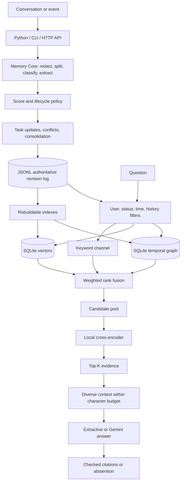

# CogniMem

**A local-first, temporal memory system for personalized AI assistants.** CogniMem turns conversations into inspectable memories, keeps track of changes, and retrieves cited evidence for later answers. It combines a learned-plus-rule-based importance score, task and conflict management, a temporal knowledge graph, vector search, local reranking, and retrieval-augmented generation (RAG).

For the project objective, practical uses, implementation layers, data flows, and remaining goals, read [What we are building and why](PROJECT_VISION.md).

> **Research question:** How much does temporal and relational graph retrieval improve vector-based conversational memory retrieval and RAG? The controlled experiment compares vector-only, vector + reranker, vector + graph, and vector + graph + reranker while holding the dataset, prompt, answer policy, context size, and evaluation procedure fixed.

## Why build it?

An ordinary chat model has no reliable, structured account of everything a person said before. Saving every message verbatim is insufficient: greetings and obsolete reminders compete with useful facts; repeated statements waste space; newer facts may contradict older ones; and semantic similarity alone may miss time and relationships. “Where did I live before Bengaluru?” requires history, while “Where is the company I work for based?” may require a two-edge evidence path. A personalized answer should also show which memories support it.

CogniMem separates those responsibilities. It decides what to retain, preserves corrections and provenance, represents relationships with valid and recorded time, searches several evidence channels, and constrains answers to cited context. A personal assistant could remember communication preferences; a project copilot could track decisions, collaborators, and changing facts; a task assistant could retain deadlines and recurring work. The integrating application still owns the chat interface, consent, and any calendar or reminder delivery.

## System architecture



JSONL is the source of truth; vector and graph data are rebuildable indexes. Hybrid channels contribute candidates independently before fusion. The reranker runs locally and falls back to fusion order if it fails. Memory text is sent to Gemini only when a hosted answer is requested; intake, embeddings, graph search, and reranking run locally.

The three main flows are:

1. **Save:** accept a user statement → redact and classify it → compute features, score, and tier → reconcile supported claims/tasks → append a revision to JSONL → synchronize rebuildable indexes on search or explicit indexing.
2. **Update:** accept a new statement or task operation → find the relevant user-owned memory → revise task/conflict/consolidation state → append the new state without losing earlier revisions → refresh index views.
3. **Retrieve and answer:** filter visible memories by user and requested time → collect independent keyword/vector/graph candidates → fuse and optionally rerank → select diverse Top-K evidence → assemble bounded context → return cited extractive or Gemini statements.

<a id="evaluation-and-measured-results"></a>

## How to read the results

Each layer below says what it does, how it is built, which problems the 12 Oct 2026 re-measurement found in it and how they were fixed, and its metrics. Every metric has three columns:

| Column | Snapshot | What ran |
| --- | --- | --- |
| Baseline | `baseline`, 12 Oct 2026 | The rebuilt harness before any fix. |
| Final | `final`, 12 Oct 2026 | All fixes, with the rule-based importance score. |
| Current | `hybrid`, 16 Oct 2026 | The shipped default: importance = 25 % trained model + 75 % rules (Layer 2). |

Only the retention, classification and lifecycle measurements use the importance score. The benchmark and LoCoMo runners never call it, so for their metrics Current equals Final, marked "=". Every number comes from a tagged snapshot in [`evaluation/reports/`](evaluation/reports/) (`<tag>_summary.json`); the [evaluation guide](evaluation/README.md) describes the protocol. Metrics from different datasets measure different things, so do not compare their percentages with each other.

| Measurement | Data | Size |
| --- | --- | --- |
| Controlled benchmark | AI-authored: 12 personas, 456 memories; tuned on the dev split only | Test split: 270 questions (247 answerable, 23 unanswerable) |
| LoCoMo | Generated dialogue, 10 conversations; conversations 1–3 were used to choose the reranker pool | 1,973 questions |
| LongMemEval (oracle) | Real chat histories with labelled answer turns | 457 examples, 9,831 turns |
| Classification cases | AI-authored, labelled before the classifier ran | 60 cases |
| Lifecycle checks | Developer-written task, tier and supersession checks | 16 checks |
| csv5k | AI-generated memory sentences with synthetic importance scores (trains the importance model) | 5,000 rows, 86 distinct test sentences |

The metrics saved on 29 Sep 2026 looked strong but did not hold up on re-measurement, so on 12 Oct every cache, model and report was rebuilt from scratch with a new harness and a new benchmark; each layer lists what that rebuilt baseline exposed.

## Layer 1: Understand and structure incoming information

**What it does:** turns a raw message into a structured, privacy-safe memory candidate: redacted text, a category, numeric features, and any claims or relations.

| Step | What happens | Code |
| --- | --- | --- |
| Input | `MemoryCore` receives `MemoryInput`: text, user and session IDs, role, timestamp, optional metadata. | [`main/application/core.py`](main/application/core.py) |
| Redact | Supported sensitive patterns are removed before scoring or storage. | [`main/domain/privacy.py`](main/domain/privacy.py) |
| Split | Optional segmentation creates separate records for clearly independent clauses. | [`main/domain/segmentation.py`](main/domain/segmentation.py) |
| Classify | Six rule-based categories (below). | [`main/domain/classification.py`](main/domain/classification.py), [`text_rules.py`](main/domain/text_rules.py) |
| Extract | Numeric cues: deadlines, preference and task language, entity density, recency, interaction signals, category. | [`main/domain/features.py`](main/domain/features.py) |
| Claims and relations | Supported factual statements become claims; callers can add typed entities and relations for the graph. | [`main/domain/claims.py`](main/domain/claims.py), [`main/graph/`](main/graph/) |

| Category | Typical input | Why it matters later |
| --- | --- | --- |
| Semantic | “My supervisor is Priya.” | Stable facts and relationships. |
| Episodic | “I submitted the proposal yesterday.” | Event history and temporal questions. |
| Procedural | “First run tests, then deploy.” | Reusable instructions. |
| Preference | “I prefer brief explanations.” | Personalization and constraints. |
| Task | “Remind me to submit the report Friday.” | Action state, deadlines, recurrence. |
| Temporary | “Thanks!” | Immediate context without durable retention. |

| Problem found in the baseline | Evidence | Fix | Code |
| --- | --- | --- | --- |
| Users' own facts inside questions and hedges were labelled temporary (“I'm planning a trip to Lisbon in May, can you suggest neighbourhoods?”). | 86% of LongMemEval answer turns were labelled temporary. | Questions and hedges that carry first-person facts become episodic; small talk and questions that ask to recall a stored fact stay temporary. | [`text_rules.py`](main/domain/text_rules.py), [`classification.py`](main/domain/classification.py) |
| The saved “48/48 classification cases (100%)” had been used to develop the rules. | The cases were not held out. | 60 new AI-authored cases, labelled before the classifier was run. | [`evaluation/classification.py`](evaluation/classification.py) |

| Metric (60 classification cases) | Baseline | Final | Current |
| --- | ---: | ---: | ---: |
| Category accuracy | 50.0% | 53.3% | 53.3% |
| Category macro F1 | 0.516 | 0.544 | 0.544 |

The importance model does not change categories: the record's category always comes from these rules.

## Layer 2: Score, retain, and manage change

**What it does:** decides how important each memory is and how long it stays (the diagram's “Score and lifecycle policy”), then keeps tasks, conflicting facts and duplicates consistent over time (“Task updates, conflicts, consolidation”).

| Part | What it does | Code |
| --- | --- | --- |
| Importance score | **25 % a trained model + 75 % rules** (details below). | [`main/ensemble.py`](main/ensemble.py), [`main/domain/scoring.py`](main/domain/scoring.py) |
| Lifecycle tiers | Working (temporary or score < 0.25, expires after 1 hour); short-term (14 days, or 90 days for what users say about their own lives); long-term (durable categories scoring ≥ 0.42, shown as archive after 90 inactive days); dated tasks expire 24 hours after their deadline. These are policy decisions, not human-labelled truths. | [`main/domain/lifecycle.py`](main/domain/lifecycle.py) |
| Conflicts and consolidation | A newer supported fact becomes the current assertion while the older one and its history are kept (“I live in Chennai” → “I moved to Bengaluru”). Repeated memories consolidate into one summary with their evidence. | [`main/domain/reconciliation.py`](main/domain/reconciliation.py) |
| Tasks | Due dates, completion, cancellation, rescheduling and recurrence; ambiguous references are recorded, not applied to an unrelated task. | [`main/domain/tasks.py`](main/domain/tasks.py), [`task_updates.py`](main/domain/task_updates.py) |
| Cleanup | Previews by default. The balanced policy keeps expired memories scoring ≥ 0.65, durable categories, legal holds, evidence and open tasks; applied cleanup deletes the rest and compacts exact duplicate revisions. | [`main/storage/cleanup.py`](main/storage/cleanup.py) |

### Importance scoring (default)

```
model_score = class value: low 0.3102 · mid 0.5792 · high 0.8372    (× 0.25 for small talk, as the rules do)
score       = round(0.25 × model_score + 0.75 × rule_score, 4)
```

| Part | Detail |
| --- | --- |
| Training data | csv5k (`cognimem_memory_importance_5000.csv`): 5,000 AI-generated memory sentences (443 distinct) with synthetic importance scores 0.20–1.00, cut into low < 0.4 ≤ mid < 0.7 ≤ high. Every copy of a sentence stays in one split: 3,200 / 792 / 1,008 rows. |
| XGBoost member | 525 features (13 text features + 512 hashed word counts); max depth 3, min child weight 3, 304 rounds; temperature-calibrated. |
| Neural member | Frozen `BAAI/bge-small-en-v1.5` embedding (384 values) + the 13 text features: text branch 384→192→128, feature branch 13→64→32, joint head 160→128→64→3; seeds 42, 43, 44 averaged and calibrated. |
| Blend and thresholds | 0.5 × XGBoost + 0.5 × neural, then class weights 1 / 0.7 / 1 pick low / mid / high; all chosen on validation only. |
| Class values | The mean csv5k importance of the fit and validation sentences in each class (the test split is excluded). |
| Files and switch | [`artifacts/importance_ensemble/`](artifacts/importance_ensemble/) (2.5 MB, checksummed, tracked in Git; rebuilt bit for bit by [`training/ensemble/`](training/ensemble/)). `COGNIMEM_SCORER=heuristic`, `process --scorer heuristic` or `MemoryCore.with_heuristic()` uses the rules alone. Every record stores the model's class, probabilities and both part-scores in `source_metadata["importance_model"]`. |

The model is new, so it has no baseline; on the csv5k test split (1,008 rows, 86 sentences; 95% intervals over whole sentences; [full report](evaluation/reports/retention_ensemble.md)) it is compared with the reference rows:

| Model | Accuracy | Balanced accuracy | Macro F1 [95% CI] | F1 low / mid / high |
| --- | ---: | ---: | --- | --- |
| Always the most common class | 61.11% | 33.33% | 0.2529 [0.220, 0.283] | 0.00 / 0.00 / 0.76 |
| Best possible (oracle) | 91.17% | 92.86% | 0.9230 [0.885, 0.957] | 1.00 / 0.84 / 0.93 |
| **Ensemble + thresholds** | 89.09% | 87.14% | 0.8912 [0.809, 0.949] | 1.00 / 0.76 / 0.92 |

The oracle predicts each test sentence's most common test label: a ceiling that reads the test labels, not a model.

| Problem found | Evidence | Fix | Code |
| --- | --- | --- | --- |
| Users' own statements expired after one hour. | LongMemEval user-fact retention 21.0%. | What users say about their own lives is kept 90 days instead of 14 (with the Layer 1 category fix). | [`lifecycle.py`](main/domain/lifecycle.py) |
| The trained retention models (XGBoost and two neural heads on Personal Facts) were separate, flag-enabled options that predicted fact validity and never ran by default. | Optional `--scorer xgboost/neural`. | Replaced by one built-in model trained on importance (csv5k “Ensemble + thresholds”), as 25 % of every score. The old models are backed up outside the repository. | [`main/ensemble.py`](main/ensemble.py), [`training/ensemble/`](training/ensemble/) |
| The trained model rates greetings and small talk as important: it never saw conversation in training. | “hello” and “ok” come out *high*. | Its part is multiplied by 0.25 for small talk, the same penalty the rules apply. | [`main/ensemble.py`](main/ensemble.py) |
| The evaluation runners read the wall clock, so tier results depended on the time of day. | Rerunning the unchanged rule-based score on another day moved classification tier accuracy, because the recency feature decays over a day. | The classification and lifecycle runners pin their clock to the cases' timestamp. | [`evaluation/clock.py`](evaluation/clock.py) |

| Metric | Baseline | Final | Current |
| --- | ---: | ---: | ---: |
| LongMemEval user-fact retention (457 examples) | 21.0% | 90.6% | 90.6% |
| Mean share of a conversation still visible | 18.2% | 55.2% | 55.2% |
| Cleanup: expired memories deleted | 3,160 | 1,740 | 1,738 |
| Cleanup: expired memories kept as archive | — | 33¹ | 38 |
| Classification cases: tier accuracy | 55.0% | 53.3% | 56.7%² |
| Classification cases: score inside the labelled range | 48.3% | 50.0% | 58.3%³ |
| Lifecycle, task and supersession checks | 16/16 | 16/16 | 16/16 |
| LongMemEval replay time | 13 s | 13 s | 581 s |

¹ Not recorded in `final`; a same-day rerun of the rule-based score (`heuristic_control`, which reproduces `final` on all 457 examples) kept 33.
² The clock pin, not the model: the same-day rule-based run also gives 56.7%.
³ Not better judgement: a constant score of 0.5 lands inside 83.3% of the labelled ranges.

What the model changed, measured against the same-day rule-based run:
- **Retention did not change.** Every one of the 457 examples kept the same answer turns and the same visible share; at 25 % weight the model did not change the visibility of a single answer turn. Cleanup kept 5 more expired memories as archive and deleted 2 fewer.
- **It does not recognise answer-bearing turns.** As a ranking of answer turns against the rest, its score has an AUC of 0.482 on user turns (rules: 0.582); the blended score's overall AUC is 0.654 against 0.678. It labels 81.2% of turns *high*, and 98.9% of turns lie more than 5 standard deviations from its training data: conversation turns are far longer than the at most 13-word csv5k sentences.
- **It costs time.** Each memory is embedded with BGE (about 59 ms on average), so the LongMemEval replay took 41× longer.

Caveats: csv5k is synthetic (AI-written sentences and scores, not human ratings) and its test split has only 86 distinct sentences; the 25 % weight is a fixed choice, not a tuned one; two lifecycle-check texts (“I live in Chennai.”, “I live in Bengaluru.”) appear verbatim in csv5k; records stored before the switch keep their rule-based score.

## Layer 3: Persist memories and temporal relationships

**What it does:** keeps every revision of every memory, and the rebuildable indexes that search needs.

| Part | What it does | Code |
| --- | --- | --- |
| Revision log | `LocalMemoryStore` appends serialized `MemoryRecord` revisions to `memory_store/memories.jsonl`, the source of truth: category, tier, score, timestamps, task state, claim and conflict status, evidence IDs and source metadata. | [`main/storage/store.py`](main/storage/store.py) |
| Locks | Cross-process locks guard local operations. | [`main/storage/locking.py`](main/storage/locking.py) |
| Indexes | SQLite holds chunks and embeddings, graph nodes and edges, aliases and index state; all rebuildable from the log. | [`main/storage/indexes.py`](main/storage/indexes.py) |
| Vector search | Exact numpy scan by default; approximate LSH search is opt-in (`--ann`) and experimental. | [`main/storage/indexes.py`](main/storage/indexes.py) |
| Temporal graph | Typed relations (`lives_in`, `works_at`, `based_in`, `likes`, `has_task`) linked to their source memory, with **valid time** (when it was true) and **recorded time** (when the system learned it); `--as-of` and `--known-at` separate past truth from past knowledge. Graph connectivity alone is never treated as proof of an unstated fact. | [`main/graph/`](main/graph/) |

| Problem found in the baseline | Evidence | Fix | Code |
| --- | --- | --- | --- |
| Approximate (LSH) search was on by default from 256 memories and dropped most candidates; the saved LoCoMo Recall@5 of 55.83% had been measured with exact search, so the shipped path was never measured. | Benchmark Recall@5 93.0% exact vs 57.5% with LSH; LoCoMo 55.8% vs 26.8%. | Exact search by default. LSH is opt-in, probes radii 0–2 until it has enough candidates, falls back to exact search, and rebuilds when its settings change. | [`indexes.py`](main/storage/indexes.py), [`rag.py`](main/retrieval/rag.py), [`api/config.py`](api/config.py) |

| Metric (approximate search forced on; the default is exact) | Baseline | Final | Current |
| --- | ---: | ---: | ---: |
| Benchmark Recall@5 | 57.5% | 97.5% | 97.5% = |
| Benchmark: gold memory in the reranker pool | 66.4% | 100.0% | 100.0% = |
| LoCoMo Recall@5 | 26.8% | 66.5% | 66.5% = |
| LoCoMo: gold evidence in the reranker pool | 33.3% | 90.6% | 90.6% = |

## Layer 4: Retrieve and rank evidence

**What it does:** finds the memories that answer a question, from several independent channels, and orders them.

| Step | What happens | Code |
| --- | --- | --- |
| Filter | Visible memories only: by user, session, history, task state, expiry and requested time. | [`main/retrieval/rag.py`](main/retrieval/rag.py) |
| Channels | Keyword (lexical overlap; weights keyword 0.65, category 0.10, tier 0.05, recency 0.10, importance 0.10), vector (BGE embeddings) and graph each propose candidates independently; recency mode lists newest first. | [`ranker.py`](main/retrieval/ranker.py), [`embeddings.py`](main/retrieval/embeddings.py), [`main/graph/`](main/graph/) |
| Fusion | Weighted reciprocal-rank fusion over memory IDs keeps `min(200, max(100, 4 × Top-K))` candidates (`COGNIMEM_CANDIDATE_POOL` overrides). Fusion order is computed at the old depth and deeper candidates are appended, so the wider pool never reorders results when reranking is off or fails. | [`main/retrieval/rag.py`](main/retrieval/rag.py) |
| Rerank | Up to three chunks per candidate go to the local `Xenova/ms-marco-MiniLM-L-6-v2` cross-encoder; each memory keeps its best chunk. A model failure returns fused results with fallback metadata. `--no-rerank` exposes the fusion baseline. | [`main/retrieval/reranker.py`](main/retrieval/reranker.py) |
| Structural reordering | Candidates with a cued, currently valid graph path move up and their chain partners follow; a statement whose relation has closed yields to its successor when the question asks about that relation. | [`main/retrieval/rag.py`](main/retrieval/rag.py) |

| Problem found in the baseline | Evidence | Fix | Code | Measured change |
| --- | --- | --- | --- | --- |
| The saved benchmark Recall@5 of 91.36% came from 240 template questions written alongside the rules; procedural questions scored 5% because `ingest()` merged 19 of their 20 memories. | Not a held-out measurement. | New AI-authored benchmark (12 personas, 456 memories, 360 questions, dev 90 / test 270), tuned on dev only. | [`evaluation/`](evaluation/) | — |
| The reranker saw too few candidates. | LoCoMo gold evidence reached the 20-item reranker pool only 69.6% of the time. | The reranker sees 100 fused candidates instead of 20; fusion order without the reranker is unchanged, the 600-character cap is gone, and limits 51–100 no longer crash. | [`rag.py`](main/retrieval/rag.py), [`reranker.py`](main/retrieval/reranker.py) | LoCoMo Recall@5 55.8% → 66.8% (+11.0 [+9.5, +12.5]); on the 7 conversations not used to choose the pool, 55.7% → 66.8%. Benchmark +0.6 points (not significant). |
| The reranker ignored time and graph links. | Correct memory first: temporal 27.3%, historical 52.2%; multi-hop Recall@5 68.2% (90.9% before reranking). | Time- and link-aware reordering after the reranker (above). The “newer of two statements” step is opt-in, because its gains did not survive paraphrase. | [`rag.py`](main/retrieval/rag.py) | Benchmark Recall@5 93.7% → 97.5% (+3.8 [+2.2, +5.7]); correct first 77.3% → 84.2% (+6.9 [+3.6, +10.5]); LoCoMo unchanged (it has no stored relations). |
| `search(mode='recency')` always raised. | A crash on every call. | The custom-channel check no longer rejects the built-in recency mode. | [`rag.py`](main/retrieval/rag.py) | Works. |

Intervals are paired-bootstrap 95% CIs. The research-question arms on the benchmark test split (Recall@5):

| Arm | Baseline | Final | Current |
| --- | ---: | ---: | ---: |
| Vector | 89.7% | 89.7% | 89.7% = |
| Vector + reranker | 92.4% | 93.7% | 93.7% = |
| Vector + graph | 94.1% | 94.1% | 94.1% = |
| Vector + graph + reranker | 92.4% | 97.5% | 97.5% = |
| Hybrid (keyword + vector + graph) + reranker, shipped | 93.0% | 97.5% | 97.5% = |

| Metric (hybrid + reranker) | Baseline | Final | Current |
| --- | ---: | ---: | ---: |
| *Benchmark, test split (247 answerable)* | | | |
| Recall@5 | 93.0% | 97.5% | 97.5% = |
| Recall@10 | 97.6% | 99.5% | 99.5% = |
| MRR / nDCG@10 | 0.904 / 0.879 | 0.939 / 0.933 | 0.939 / 0.933 = |
| Correct memory first | 77.3% | 84.2% | 84.2% = |
| Correct first: temporal / historical / preference | 27.3% / 52.2% / 82.6% | 59.1% / 91.3% / 91.3% | 59.1% / 91.3% / 91.3% = |
| Correct first: correction / latest update | 54.5% / 43.5% | 54.5% / 39.1% | 54.5% / 39.1% = |
| Multi-hop Recall@5 | 68.2% | 100.0% | 100.0% = |
| Search latency P50 | 85 ms | 246 ms | 246 ms = |
| *LoCoMo evidence retrieval (1,973 questions)* | | | |
| Recall@5 | 55.8% | 66.8% | 66.8% = |
| Hit@5 / Recall@10 | 61.1% / 60.0% | 72.3% / 73.4% | 72.3% / 73.4% = |
| MRR@5 | 0.505 | 0.589 | 0.589 = |
| Gold evidence in the reranker pool | 69.6% | 91.9% | 91.9% = |
| Multi-hop Recall@5 | 34.7% | 41.8% | 41.8% = |
| Search latency P50 | 119 ms | 435 ms | 435 ms = |

What did not improve: correction questions (“scratch that…”) stay at 54.5% correct first, and latest-update questions moved 43.5% → 39.1% (one question). Latency rose about 3–4×, mostly from the 5× larger reranker pool; `COGNIMEM_CANDIDATE_POOL=50` keeps most of the LoCoMo gain at about half the reranker cost. The graph channel alone finds almost no LoCoMo evidence (Recall@5 1.2%), because raw dialogue turns carry no explicit relations. The [full benchmark report](docs/reports/final/ablation/results.md) breaks results down by arm, query type and number of gold memories (regenerated locally under the git-ignored `docs/`).

## Layer 5: Build context and answer

**What it does:** turns the ranked evidence into a bounded context and a cited answer, or a refusal.

| Part | What it does | Code |
| --- | --- | --- |
| Context | Keeps the reranked order (fusion-only results still prefer query coverage), removes near-duplicate snippets and respects a character budget; per-source scores go to `context['scores']`, outside the prompt text. Graph paths are included only when all their memories fit. | [`main/retrieval/rag.py`](main/retrieval/rag.py) |
| Extractive answer | `ask --generator extractive`: local, deterministic evidence text. | [`main/retrieval/generation.py`](main/retrieval/generation.py) |
| Hosted answer | The default `ask` path uses LangChain/Gemini 2.5 Flash once a key is configured; memory text leaves the machine only then. | [`main/retrieval/generation.py`](main/retrieval/generation.py) |
| Citation check | Hosted output must contain source IDs and exact supporting quotes from the supplied context; invalid citations are rejected. Quote checking proves provenance, not every semantic inference. | [`main/retrieval/generation.py`](main/retrieval/generation.py) |
| Abstention (opt-in) | `--abstain` refuses typed questions (name, place, occupation, amount, duration…) that no confidently reranked memory answers. | [`main/retrieval/generation.py`](main/retrieval/generation.py) |

| Problem found in the baseline | Evidence | Fix | Code | Measured change |
| --- | --- | --- | --- | --- |
| The context did not follow the reranker's order. | The first statement of the answer was not necessarily the top-ranked memory. | The context follows the reranked order and exposes per-source scores outside the prompt. | [`rag.py`](main/retrieval/rag.py) | The first statement is now the top-ranked memory: 84.2% correct. |
| No abstention: the saved “abstention accuracy 91.67%” counted answerable questions as correct. | The extractive answerer refused 0% of the unanswerable questions. | Opt-in extractive abstention (above); off by default. | [`generation.py`](main/retrieval/generation.py), [`main/__main__.py`](main/__main__.py) | Unanswerable refused 0% → 17.4%; external sets show no useful gain ([details](evaluation/reports/abstention_external.json)). |

| Metric (benchmark test split, hybrid + reranker) | Baseline | Final | Current |
| --- | ---: | ---: | ---: |
| Grounded correctness, answerable questions (247) | 97.6% | 99.2% | 99.2% = |
| Grounded correctness, all questions (270) | 89.3% | 90.7% | 90.7% = |
| Unanswerable refused (opt-in abstention) | 0% | 17.4% | 17.4% = |
| Answerable still answered (opt-in abstention) | 100.0% | 99.6% | 99.6% = |
| Balanced answerability (opt-in abstention) | 50.0% | 58.5% | 58.5% = |

The abstention rows come from the `final_abstain` snapshot (`final` plus `--abstain`); without the flag the system never refuses. Grounded correctness on answerable questions rose 1.6 points: 4 of 247 questions became correct and none became wrong. That is too few changes to be significant (two-sided sign-flip test p = 0.13; the bootstrap interval [+0.4, +3.2] is unreliable with so few non-zero differences).

## Layer 6: Expose and operate the system

**What it does:** gives applications and people safe access to the memory system.

| Interface | What it offers | Code |
| --- | --- | --- |
| CLI | Ingestion, inspection, search, graph queries, answers, history, reconciliation and cleanup; the caller supplies a user ID. | [`main/__main__.py`](main/__main__.py) |
| Python | `MemoryCore`, `LocalMemoryStore` and `MemoryRAG` used directly. | [`main/`](main/) |
| HTTP API | FastAPI with signup/login, bearer tokens, role checks, per-user memory endpoints, search, JSON/CSV export and account deletion; the user ID comes from the authenticated identity. | [`api/`](api/) |
| Operations | `/health/live`, `/health/ready` (reports the importance scorer), `/metrics` (Prometheus), structured request logs and `/docs`; the web demo is mounted at `/demo` when static assets are present. Settings are validated at start-up, and the importance model and encoder are loaded there, so a misconfiguration stops the API instead of failing requests. | [`api/app.py`](api/app.py), [`api/config.py`](api/config.py), [`static/`](static/) |

| Problem found in the baseline | Evidence | Fix | Code |
| --- | --- | --- | --- |
| A bad `COGNIMEM_*` value could leave the module-level app as `None` without an error. | `COGNIMEM_ANN_EXACT_THRESHOLD=0` passed configuration and then disabled the app. | Settings are validated in `Settings.from_env`; once a JWT secret is configured, a bad value fails loudly. | [`api/config.py`](api/config.py), [`api/app.py`](api/app.py) |

## Setup

Run commands from the repository root. Python 3.13 and [uv](https://docs.astral.sh/uv/) are the development path used here; a standard virtual environment and `pip install -r requirements.txt` can also be used if the pinned packages support your platform.

```bash
uv venv --python 3.13 .venv
uv pip install --python .venv/bin/python -r requirements.txt
.venv/bin/python -m main --help
```

Local embedding and reranker models download on first use into the ignored cache under `data/rag/models/`. Store and index files are local runtime data. The default importance scorer also needs the BGE encoder in that cache, and reads it only from there: run a semantic search once, or `.venv/bin/python -c "from main.retrieval.embeddings import FastEmbedder; FastEmbedder()"`, before the first `process`. Its model files ship in `artifacts/importance_ensemble/`; `COGNIMEM_SCORER=heuristic` runs without both.

For a hosted answer, copy the example environment file and set your key locally. The extractive generator needs no key.

```bash
cp .env.example .env
# Edit .env and set GOOGLE_API_KEY; GEMINI_API_KEY is also accepted.
.venv/bin/python -m main ask "What style of answer do I prefer?" \
  --user-id user_001 --generator gemini
```

The CLI `ask` command loads `.env` by default. The API reads its process environment and also requires a JWT secret of at least 32 bytes:

```bash
export COGNIMEM_JWT_SECRET="$(.venv/bin/python -c 'import secrets; print(secrets.token_urlsafe(48))')"
.venv/bin/python -m api
# Visit http://localhost:8000/docs for the endpoint schemas.
```

`COGNIMEM_STORE`, `COGNIMEM_AUTH_DB`, and `COGNIMEM_INDEX` override local paths. Vector search is exact by default; `COGNIMEM_ANN_ENABLED=true` (CLI: `--ann`) enables LSH for users with at least `COGNIMEM_ANN_EXACT_THRESHOLD` memories (default 5000, must be >= 1). `COGNIMEM_CANDIDATE_POOL` (1-200) and `COGNIMEM_MODEL_THREADS` (default: onnxruntime decides) tune reranking. Keep `.env`, tokens, and generated runtime data out of version control.

## First local workflow

These commands save a preference and a location change, then retrieve the current evidence for the same user. First semantic use may download and initialize local models.

```bash
.venv/bin/python -m main process "I prefer concise technical explanations." \
  --user-id user_001 --session-id session_001 --pretty
.venv/bin/python -m main process "I live in Chennai." \
  --user-id user_001 --session-id session_001
.venv/bin/python -m main process "I moved to Bengaluru." \
  --user-id user_001 --session-id session_002

.venv/bin/python -m main list --user-id user_001 --pretty
.venv/bin/python -m main search "Where do I live now?" \
  --user-id user_001 --mode hybrid --limit 5 --pretty
.venv/bin/python -m main ask "Where do I live now?" \
  --user-id user_001 --generator extractive --pretty
```

`index --user-id user_001` builds indexes explicitly; `graph --user-id user_001 --query Bengaluru` inspects relations; `history RECORD_ID --user-id user_001` shows revisions. Keyword search avoids model downloads. `ask --preview` shows context and prompt without calling Gemini. `--no-rerank` and `--candidate-limit 20` support retrieval comparisons. `cleanup --user-id user_001` previews cleanup; `--apply` executes it. Use `.venv/bin/python -m main COMMAND --help` for flags.

Python applications use the same core and store:

```python
from main import LocalMemoryStore, MemoryCore, MemoryInput
from main.retrieval.rag import MemoryRAG

store = LocalMemoryStore()
record = MemoryCore().process(MemoryInput(
    content="I prefer concise technical explanations.",
    user_id="user_001",
    session_id="session_001",
))
store.save(record)
hits = MemoryRAG(store).search("How should you answer me?", user_id="user_001")
print([(hit["memory_id"], hit["text"]) for hit in hits])
```

`process` uses the hybrid importance scorer by default; pass `--scorer heuristic` (or set `COGNIMEM_SCORER=heuristic`, or use `MemoryCore.with_heuristic()` in Python) for the rule-based score alone. The scorer changes retention scoring, not the retrieval model.

An HTTP integration can call the running API instead. Signup returns a bearer token; use its `data.access_token` value in subsequent requests. The authenticated identity determines which memories the caller can access.

```bash
curl -sS http://localhost:8000/api/v1/auth/signup \
  -H 'Content-Type: application/json' \
  -d '{"email":"demo@example.com","password":"a-long-demo-password"}'

# Copy data.access_token from the response into this shell variable.
export COGNIMEM_DEMO_TOKEN='paste-token-here'
curl -sS http://localhost:8000/api/v1/memories \
  -H "Authorization: Bearer $COGNIMEM_DEMO_TOKEN" \
  -H 'Content-Type: application/json' \
  -d '{"content":"I prefer concise answers.","session_id":"demo-session"}'
curl -sS http://localhost:8000/api/v1/memories/search \
  -H "Authorization: Bearer $COGNIMEM_DEMO_TOKEN" \
  -H 'Content-Type: application/json' \
  -d '{"query":"How should you answer me?","mode":"keyword","limit":5}'
```

The `/docs` page documents the other endpoints. Token, store, and index files are local runtime state; do not commit them.

## Reproduce the experiments

After installation, run from the repository root:

```bash
.venv/bin/python -m training.ensemble.run --csv ~/Downloads/cognimem_memory_importance_5000.csv   # importance model (about 30 s)
.venv/bin/python scripts/measure_all.py --tag final --candidate-limit default --ann-arms   # every measurement
.venv/bin/python scripts/measure_all.py --tag hybrid --scorer-steps-only                  # only what the importance scorer affects
.venv/bin/python scripts/measure_all.py --tag heuristic_control --scorer-steps-only --scorer heuristic
.venv/bin/python scripts/report_delta.py baseline final --allow-dataset-mismatch
.venv/bin/python scripts/report_delta.py heuristic_control hybrid
```

`measure_all.py` runs the benchmark ablation (test and dev), LoCoMo, LongMemEval retention, classification and lifecycle checks, and snapshots the reports under the tag; `--scorer-steps-only` runs just the last three, and `--scorer` picks the importance scorer. The first run downloads the models and datasets, and a full run takes about an hour on a laptop. `--abstain-threshold 0.0` measures the opt-in abstention rule, and `--structure none` disables the time- and link-aware reordering. The [evaluation guide](evaluation/README.md) lists every flag and module.

To run the automated tests, install the test runner (`uv pip install --python .venv/bin/python -r requirements-dev.txt`), then run `.venv/bin/python -m pytest -q`.

## Repository map

| Path | Responsibility |
| --- | --- |
| [`main/domain/`](main/domain/) | Models, text rules, classification, scoring, lifecycle, tasks, privacy, claims, reconciliation. |
| [`main/application/`](main/application/) | Memory Core orchestration and maintenance. |
| [`main/storage/`](main/storage/) | JSONL revisions, locks, SQLite index structures, cleanup. |
| [`main/graph/`](main/graph/) | Temporal entities/relations, provenance, historical and multi-hop queries. |
| [`main/retrieval/`](main/retrieval/) | Keyword ranking, BGE embeddings, hybrid search, reranking, context, answers. |
| [`main/ensemble.py`](main/ensemble.py), [`main/ml.py`](main/ml.py), [`training/ensemble/`](training/ensemble/), [`artifacts/importance_ensemble/`](artifacts/importance_ensemble/) | Default hybrid importance scorer, its feature schema, its training, and the trained model. |
| [`api/`](api/), [`static/`](static/) | Authenticated HTTP API, monitoring, privacy operations, demo. |
| [`evaluation/`](evaluation/), [`docs/reports/`](docs/reports/) | Datasets, runners, saved metrics, failure cases, review forms. |
| [`tests/`](tests/) | Automated behavior and integration tests. |

## Limits and next steps

- **Generalization:** the controlled benchmark and classification cases were authored by an AI and are not human-validated, and its dev and test personas share templates. LoCoMo is generated dialogue, and its first three conversations were used to choose the reranker pool. Fresh conversation-disjoint data and independent human ratings are needed for a broader claim.
- **Known gaps:** correction and latest-update questions are still often answered with an older statement; abstention is opt-in and catches only "attribute never stated" questions; category classification is 53% on the 60 cases; the larger reranker pool costs about 3–4× search latency; approximate search remains experimental. One lifecycle check and one task test fail rarely because of a wall-clock race in task updates.
- **Answer quality:** saved RAG scores use extractive answers. Live Gemini correctness, personalization, citation usefulness, and conflict decisions still need independent review. Exact-quote citation validation alone cannot prove semantic truth.
- **Extraction and retention:** graph extraction and indirect contradiction handling cover supported language patterns. The trained quarter of the importance score learned from synthetic sentences, does not recognise answer-bearing conversation turns, and changed no measured retention outcome; human-rated, in-domain importance labels are needed before giving it more weight.
- **Operations:** local JSONL and SQLite are not a production database architecture. Deployment needs backups, retention-policy review, stronger authorization/abuse controls, and workload-specific scale and latency measurements.

For more implementation detail and day-to-day workflows, see [DOCUMENTATION.md](DOCUMENTATION.md). For evaluation protocols, see [evaluation/README.md](evaluation/README.md) and the saved reports linked above.
